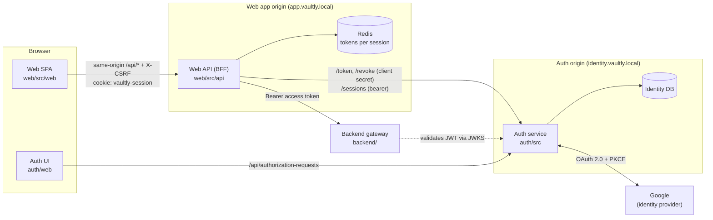
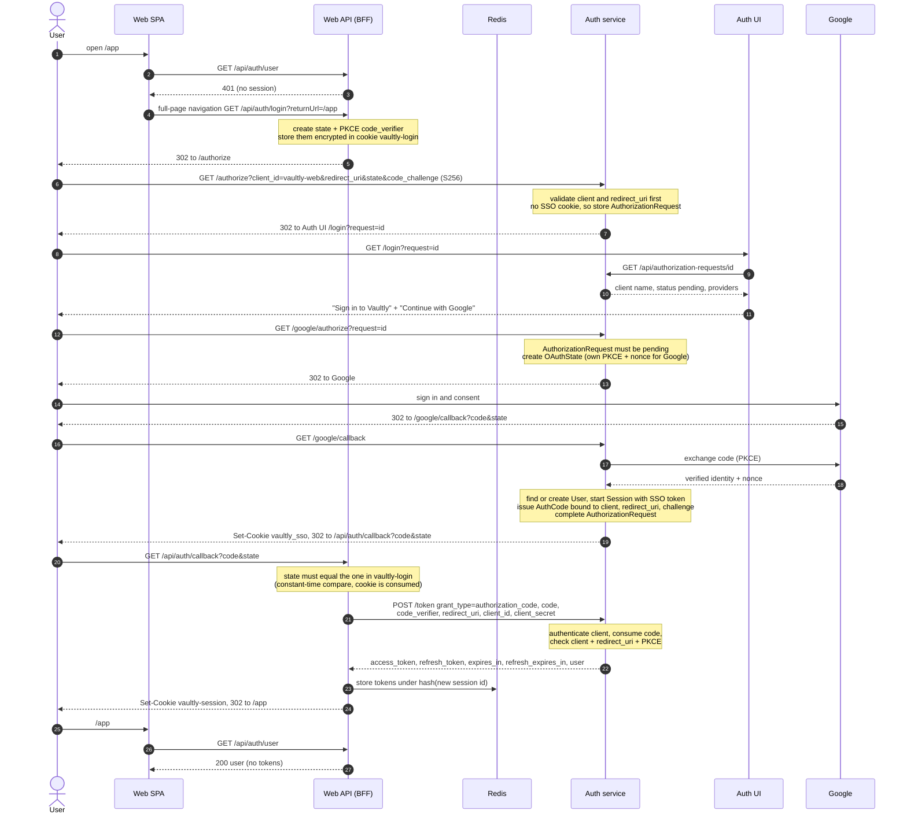
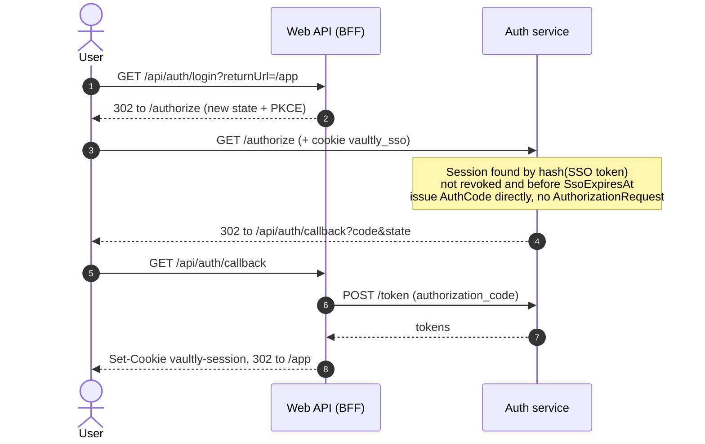
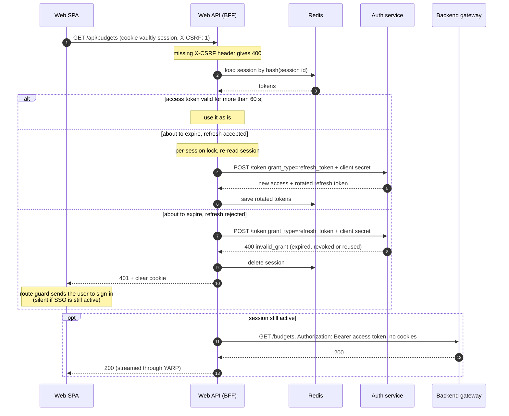
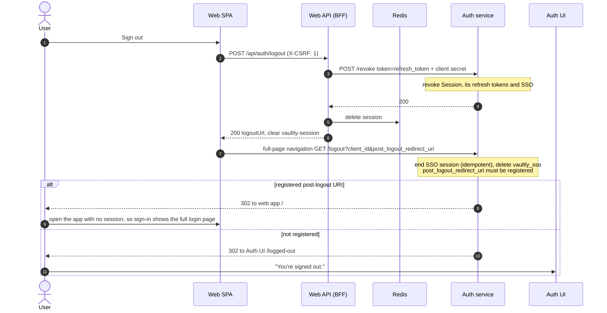
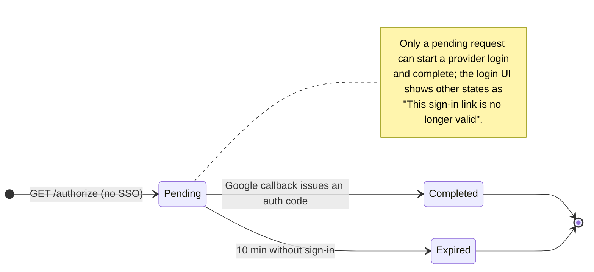
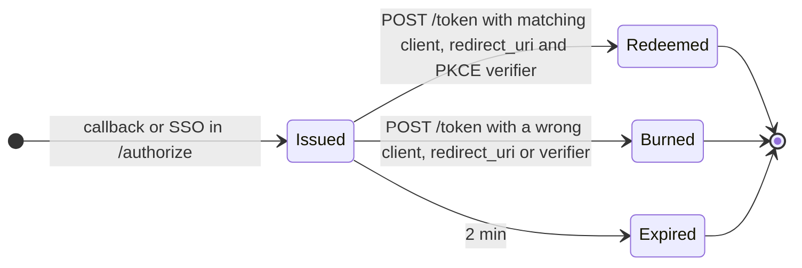

# Authentication & authorization flow

How a user signs in to Vaultly, how requests are authorized, and how sign-out works — end to end across the web
app, its backend-for-frontend, the auth service and Google. Client-integration details of the auth service live in
[`auth/docs/auth-flow.md`](../../auth/docs/auth-flow.md).

**In one sentence:** the browser only ever holds HttpOnly cookies; the web API (BFF) is a confidential OIDC client
that keeps the tokens in Redis; the auth service is a Keycloak-style authorization server with its own login UI and
an SSO session.

## Participants

| Participant | Where | Responsibility |
|---|---|---|
| Web SPA | `web/src/web` | The app. Calls only same-origin `/api/*`. No sign-in screen, no tokens. |
| Web API (BFF) | `web/src/api` | Confidential OIDC client `vaultly-web`. Owns the browser session, stores tokens in Redis, forwards API calls to the backend with a bearer token. |
| Auth service | `auth/src` | OAuth 2.0 / OIDC authorization server: `/authorize`, `/token`, `/revoke`, `/logout`, SSO session, JWT signing. |
| Auth UI | `auth/web` | The auth service's own login pages (`/login`, `/error`, `/logged-out`), served by the auth service. |
| Google | – | Identity provider used by the auth service. |
| Backend gateway | `backend/` | Business APIs; trusts JWTs issued by the auth service. |

## What is stored where

| Item | Lives in | Properties |
|---|---|---|
| `vaultly-session` cookie | Browser, web origin | HttpOnly, Secure, `SameSite=Strict`, random 256-bit id (`__Host-` prefix outside dev) |
| `vaultly-login` cookie | Browser, web origin | HttpOnly, Secure, `SameSite=Lax`, encrypted: `state`, PKCE `code_verifier`, `returnUrl`; 10 min |
| Access + refresh token | Redis (BFF) | Key = SHA-256 of the session id, value encrypted with ASP.NET Data Protection; expires with the refresh token |
| `vaultly_sso` cookie | Browser, auth origin | HttpOnly, Secure, `SameSite=Lax`, random SSO token; only its hash is stored |
| `AuthorizationRequest` | Identity DB | Client, redirect URI, client `state`, PKCE challenge; 10 min |
| `Session` | Identity DB | User sign-in = SSO session (12 h), owns auth codes and refresh tokens |
| `AuthCode` | Identity DB | Hashed, single use, 2 min, bound to client + redirect URI + PKCE challenge |
| `RefreshToken` | Identity DB | Hashed, rotated on every use, 30 days |
| Access token | JWT (RS256) | 15 min, claims `sub` (user) and `sid` (session); validated with `/.well-known/jwks.json` |

## 1. First sign-in

## 2. Silent sign-in with an active SSO session

When the web session is gone (cookie expired, new tab after clearing it, another app) but the auth service still
has an active SSO session, the user never sees a login page.

## 3. Calling APIs and refreshing tokens

Reusing an already rotated refresh token is treated as theft: the auth service revokes the whole session.

## 4. Sign-out

Only the browser can send and clear the auth-domain SSO cookie, which is why sign-out ends with a navigation to the
auth service rather than a server-to-server call alone.

## Lifecycles

## Security controls

| Threat | Control | Where |
|---|---|---|
| Token theft from the browser (XSS) | Tokens never reach the browser; only HttpOnly cookies | BFF + Redis |
| CSRF against cookie-authenticated API | `X-CSRF: 1` required on every `/api/*` call; `SameSite=Strict` session cookie | `CsrfHeaderMiddleware` |
| Login CSRF / forged callback | `state` bound to the encrypted `vaultly-login` cookie, compared in constant time | `AuthEndpoints.CallbackAsync` |
| Intercepted authorization code | PKCE S256, code bound to client + redirect URI, client secret at `/token`, single use, burned on failure | `Session.ConsumeAuthCode`, `CodeChallenge` |
| Open redirect | Clients and redirect/post-logout URIs registered per client; invalid ones are never redirected; BFF `returnUrl` must be a local path | `ClientRegistry`, `StartAuthorizationHandler`, `SanitizeReturnUrl` |
| Session fixation | New random session id on every sign-in, previous session deleted | `UserSessionService.SignInAsync` |
| Refresh token replay | Rotation on every use; reuse revokes the whole session | `RefreshSessionHandler` |
| Redis dump | Keys are hashed session ids, payloads encrypted | `DistributedWebSessionStore` |
| DB leak | Only hashes of codes, refresh tokens and SSO tokens are stored | Identity domain |
| Token leakage to the backend | BFF strips cookies and the CSRF header before forwarding | `BackendApiTransformer` |

## What the user sees when something fails

| Situation | Page |
|---|---|
| Sign-in link expired or already used | Auth UI `/login`: "This sign-in link is no longer valid." |
| Google denied or failed, callback error | Auth UI `/error?code=access_denied`, `login_failed` or `request_expired` |
| Unknown client or unregistered `redirect_uri` at `/authorize` | Auth UI `/error?code=invalid_request` |
| `state` mismatch or failed code exchange in the BFF | Web `/login?error=invalid_state` or `login_failed` with "Try again" |
| Session ended (refresh rejected) | Back to sign-in; silent if the SSO session is still active |

## Configuration

| Setting | Service | Default | Notes |
|---|---|---|---|
| `Identity:Clients[]` | auth | `vaultly-web` | Client id, secret, display name, redirect URIs, post-logout URIs (exact or `…/*`) |
| `Identity:LoginUiBaseUrl` | auth | empty (same origin) | Dev: `http://localhost:5174` (Vite) |
| `Identity:AccessTokenTtlMinutes` | auth | 15 | |
| `Identity:RefreshTokenTtlDays` | auth | 30 | |
| `Identity:AuthCodeTtlMinutes` | auth | 2 | |
| `Identity:AuthorizationRequestTtlMinutes` | auth | 10 | |
| `Identity:SsoSessionTtlHours` | auth | 12 | |
| `LoginUi:ServeSpa`, `LoginUi:SpaRootPath` | auth | `true`, `wwwroot` | Off in development |
| `Auth:IdentityBaseUrl`, `Auth:ClientId`, `Auth:ClientSecret` | web API | – | Secret only via environment (`Auth__ClientSecret`) |
| `Auth:PublicOrigin` | web API | – | Callback and post-logout URLs are built from it |
| `Auth:LoginTimeoutMinutes`, `Auth:AccessTokenRefreshSkewSeconds` | web API | 10, 60 | |
| `ConnectionStrings:Redis` | web API | `localhost:6379` | Required outside Development |

Local development ports: web SPA 5173 (proxies `/api` to 5180), web API 5180, auth service 5096, auth UI 5174
(proxies auth API paths to 5096).

## Code map

| Step | Code |
|---|---|
| SPA route guards, login redirect, logout navigation | `web/src/web/src/app/routes/*`, `web/src/web/src/domain/identity` |
| BFF login, callback, logout, user, sessions | `web/src/api/Vaultly.Web.Api/Features/Auth/AuthEndpoints.cs` |
| BFF session, refresh, lock, Redis store | `web/src/api/Vaultly.Web.Api/Features/Auth/Sessions/` |
| BFF client of the auth service | `web/src/api/Vaultly.Web.Api/Features/Auth/IdentityService/IdentityServiceClient.cs` |
| API forwarding to the backend | `web/src/api/Vaultly.Web.Api/Features/Web/ApiProxy/` |
| Auth HTTP endpoints | `auth/src/Vaultly.Identity.Api/Api/OAuthEndpoints.cs` |
| Auth use cases (CQRS) | `auth/src/Vaultly.Identity.Application/Commands/*`, `Queries/GetAuthorizationRequest` |
| Auth domain rules | `AuthorizationRequest`, `Session`, `AuthCode`, `CodeChallenge` in `auth/src/Vaultly.Identity.Domain` |
| Login UI | `auth/web/src/pages/{login,sign-in-error,logged-out}` |
