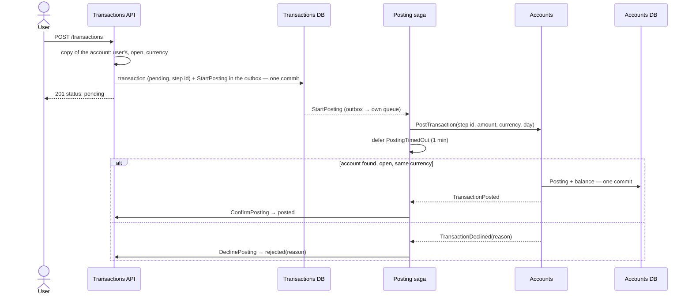

# Transaction posting

How a transaction a user enters in Transactions reaches the balance owned by Accounts, and what happens when Accounts
refuses it. Services own their databases, so the two never share a transaction; they agree through messages over
RabbitMQ (Rebus, [`core/AGENTS.md`](../../core/AGENTS.md#messaging-between-services)).

**In one sentence:** every change of a transaction that moves money is a *step* that the Transactions service's
posting saga sends to Accounts as `PostTransaction`; Accounts applies it or declines it, and Transactions confirms the
step or undoes it (compensation).

## Participants
| Who | Owns |
|---|---|
| Transactions (`transactions/`) | Transactions and their status; a copy of each account (owner, currency, closed) |
| `TransactionPostingSaga` (in Transactions) | One running step: what to send, how many times it was sent |
| Accounts (`accounts/`) | Accounts, balances, one `Posting` per transaction (what it adds to the balance) |

## Recording a transaction

Changing the amount or day and deleting run the same way, with `Change` and `Delete` steps.

## Compensation
Accounts may decline a step Transactions already accepted. Its copy of the account can lag: the user closed the account
a moment before, and `AccountClosed` has not arrived yet. The step is then undone in Transactions:

| Step | Declined → |
|---|---|
| Record | `rejected` with the reason; never touched the balance; can only be deleted |
| Change (amount or day) | back to the posted amount and day, `posted`, with the reason |
| Delete | back to `posted`, with the reason |

A transaction is `pending` while a step runs and takes no other step (409), so steps of one transaction never overlap.

## Delivery guarantees
- **Nothing lost on the way.** `StartPosting` is written to the outbox in the same commit as the pending transaction.
  Rebus forwards it after the commit, also after a crash or while RabbitMQ is down. Queues are durable, so a stopped
  Accounts gets its messages when it starts.
- **At least once, applied once.** A message can arrive twice, for example a redelivery after a crash before the
  acknowledgement. Accounts keeps the last applied step id per posting and only repeats the answer. Transactions
  ignores an answer to a step that is no longer pending. The saga ignores a second `StartPosting`. The account copy
  ignores events older than its version.
- **No answer.** The saga sends `PostTransaction` again every minute, up to 5 times, then logs an error and leaves the
  transaction pending. A message that fails 5 times in a row lands in `<service>.error` (RabbitMQ UI,
  http://localhost:15672).
